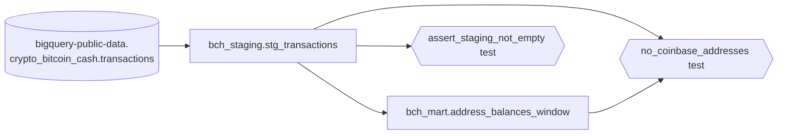

# bch-balances-dbt

dbt project on BigQuery. It reads `bigquery-public-data.crypto_bitcoin_cash.transactions` and builds two tables.

The GCP project, datasets, service account (`dbt-runner`) and WIF are created in a separate repo: `carloshgalvan95/bch-balances-terraform`.

## What gets created

- Staging: `bch_staging.stg_transactions` is a table with only the last three months of transactions.
- Mart: `bch_mart.address_balances_window` has one row per address with its balance. Addresses that received a coinbase output in the window are excluded.

### Project structure

```
.
├── .github/workflows/dbt.yml               # CI: dbt build on pull requests to main
├── macros/generate_schema_name.sql         # custom schema as is, no target prefix
├── models/
│   ├── staging/
│   │   ├── _sources.yml
│   │   ├── _staging.yml
│   │   └── stg_transactions.sql            # 3-month window, one row per transaction
│   └── marts/
│       ├── _marts.yml
│       └── address_balances_window.sql     # one row per address, coinbase receivers excluded
├── tests/
│   ├── assert_staging_not_empty.sql        # fails if staging has 0 rows
│   └── no_coinbase_addresses.sql           # fails if a mart address received a coinbase output
├── .gitattributes
├── .gitignore
├── dbt_project.yml
├── profiles.yml                            # env-var profile, 27 GB cap
├── requirements.txt                        # pinned dbt-core and dbt-bigquery
└── README.md
```



### CI

- Trigger: `pull_request` to `main`.
- Permissions: only `contents: read` and `id-token: write`.
- Auth: keyless Workload Identity Federation. No JSON key is stored.
- Every action is pinned to a full commit SHA, with the version in a comment.
- Python 3.12, `pip install -r requirements.txt` with pip cache.
- One step: `dbt build`. A failed test skips the models after it.
- Timeout 20 minutes. One run per pull request; a new push cancels the older run.
- CI on pull requests from forks stops at the Google auth step: fork pull requests get a read-only token and no OIDC token, a deliberate Workload Identity Federation control.

## Assumptions

### Window (last three months)
- The source data ends on 2024-05-13. We measured the last block at 2024-05-13 23:57:05 UTC. A window based on today's date would be empty.
- The window end is the dbt var `window_end_date`, default `2024-05-13`. It is anchored on the data, not on the current date.
- The window is the three months before that date, in UTC. Constant month bounds let BigQuery prune to 4 partitions.

### Balance
- The balance comes from window outputs only. It is the value of outputs created in the window and not spent by any input in the window.
- An address whose window outputs are all spent keeps a row with balance 0.
- An address seen only on inputs in the window gets a row with balance 0.
- So 0 means "nothing received and unspent in the window". It does not mean an empty wallet. Coins received before the window are not counted.
- `balance_window` is NUMERIC, in the source `value` unit.

### Coinbase
- "Coinbase" means the protocol transaction that pays the miner (`is_coinbase = TRUE`). The dataset has no exchange labels, so the Coinbase exchange reading cannot be built.
- The rule uses the window only: an address that received a coinbase output in the window is excluded.
- A miner paid only before the window stays in the mart.

### Multisig and empty addresses
- The mart unnests `addresses`: one row per address.
- A multisig output would credit each member with the full value. In the default window every output has exactly one address (measured: 19,485,443 of 19,485,443). Re-check if you change `window_end_date`.
- Outputs with an empty address array are dropped.

## Prerequisites

Python 3.12, `gcloud`, Terraform CLI (only to read outputs), and the Terraform repo applied (project, datasets `bch_staging` and `bch_mart`, service account, WIF).

## Steps

```bash
python -m venv .venv
source .venv/bin/activate
pip install -r requirements.txt
gcloud auth application-default login
```

Set the four variables. Values come from `terraform output` in the Terraform repo. `TF_DIR` assumes both repos are cloned side by side; change it if not:

```bash
TF_DIR=../bch-balances-terraform
export DBT_GCP_PROJECT="$(terraform -chdir="$TF_DIR" output -raw dbt_gcp_project)"
export DBT_STAGING_DATASET="$(terraform -chdir="$TF_DIR" output -raw dbt_staging_dataset)"
export DBT_MART_DATASET="$(terraform -chdir="$TF_DIR" output -raw dbt_mart_dataset)"
export DBT_LOCATION="$(terraform -chdir="$TF_DIR" output -raw dbt_location)"
export DBT_PROFILES_DIR=.
```

Run:

```bash
dbt build
```

`profiles.yml` is in the repo. It uses `method: oauth` and reads only these variables. There are no defaults, so a missing variable fails fast.

To use another window: `dbt build --vars '{window_end_date: "2024-05-13"}'`.

## Verification

- First CI run, 39369918896 (pull request #1): success in 1m22s. From the dbt log (converted from GiB): staging 6.5M rows, 19.5 GB. Mart 5.8M rows, 4.1 GB. PASS=10, ERROR=0.
- The log showed models only in `bch_staging` and `bch_mart`, no dataset creation, no 403, no stored test failures.
- Second CI run, 39370456130 (new push to the same pull request): success in 1m15s.

## Outputs and GitHub Variables

Set six GitHub Variables (not secrets) in this repo: `GCP_WIF_PROVIDER`, `GCP_SA_EMAIL`, `DBT_GCP_PROJECT`, `DBT_STAGING_DATASET`, `DBT_MART_DATASET`, `DBT_LOCATION`. Each is the uppercase name of a Terraform output; see the mapping table in the Terraform repo README, section Outputs and GitHub Variables. CI uses all six; a local run uses only the four `DBT_*` ones.

## Design decisions

### Choices

| Topic | Chosen | Discarded | Why |
|---|---|---|---|
| Window anchor | dbt var `window_end_date`, default `2024-05-13` | `MAX(block_timestamp)` subquery; `CURRENT_DATE` | The subquery and the literal date were both dry-run before choosing: the literal date prunes partitions (the subquery scanned every partition); today's date gives an empty window. |
| Balance method | Unspent window outputs, with 0 rows | Net flow (outputs minus inputs) in the window | A real balance cannot be negative; a negative net flow is a window artifact. |
| Coinbase test | Singular test rebuilt from staging, joined to the mart, `severity: error` | Test against the public table; check in `_marts.yml`; `warn` | Checks the rule on the built table, reads only staging and the mart, and stops CI on a breach. |
| Multi-address outputs | `UNNEST`, one row per address | `ARRAY_TO_STRING` joined key | One row per address is the natural grain for "all addresses"; every output in the window has one address. |
| Schema names | `generate_schema_name` returns the custom schema as is | dbt default `<target>_<custom>` prefix | dbt writes only to the two datasets Terraform created; the `dbt-runner` service account cannot create datasets. |
| CI | `pull_request` to `main`, least-privilege token, keyless WIF, actions pinned to full SHA, single `dbt build` | `pull_request_target`; JSON key in a GitHub Secret; `dbt run` then `dbt test` | No long-lived credential; `pull_request_target` would hand a write token and an OIDC token to checked-out PR code; a failed staging test stops the mart. See CI. |

### How we got here

- Source end: Google's 2019 announcement says the data updates every 24 hours, but the table metadata showed a last change on 2024-05-14, a load date rather than the last block. We queried the last block before building any model.
- Window anchor: we dry-ran both anchors before choosing. The computed end date (`MAX(block_timestamp)`) scanned every partition; the literal date read 58.3 MB instead of 6,255.6 MB (see Cost). So the window end became a dbt var.
- Balance: net flow (outputs minus inputs) in the window was option A. It can go negative, because an address can spend coins received before the window, and a real balance never does. We chose unspent window outputs (A'), with 0 rows for fully spent addresses.
- Multi-address outputs: Google's 2019 [blog post](https://cloud.google.com/blog/products/data-analytics/introducing-six-new-cryptocurrencies-in-bigquery-public-datasets-and-how-to-analyze-them), the [GSP665 lab](https://www.skills.google/focuses/8486?parent=catalog) and the [blockchain-etl balance view](https://github.com/blockchain-etl/awesome-bigquery-views/blob/master/bitcoin/top-bitcoin-balances.sql) compute balances over full history. They join addresses with `ARRAY_TO_STRING` and do not say why. The joined key never credits one output to several addresses; that reason is ours. We chose `UNNEST`, one row per address, because the mart grain is the address and 19,485,443 of 19,485,443 window outputs have exactly one address.

## Cost (measured)

Every number is a BigQuery dry run or a job record on `bch-balances-aced` (US, on-demand).
The free tier is the first 1 TiB of on-demand query data processed per month, per billing account. Every dbt query, local and in CI, is capped at 27 GB by `maximum_bytes_billed` in the repo `profiles.yml`.

| Step | Data read |
|---|---|
| `stg_transactions` (3-month window) | 19.5 GB |
| `address_balances_window` | 4.1 GB |
| `no_coinbase_addresses` test | 1.4 GB |
| Full history, same columns (`bq` dry run only, never run) | 948.8 GB |

- The window reads 19.5 GB instead of 948.8 GB for full history: 97.9% fewer bytes.
- Partition pruning (a `bq` probe, outside dbt): the same window probe read 58.3 MB with a literal date instead of 6,255.6 MB with a computed date: 99.1% fewer bytes. The model uses the literal.
- CI bytes come only from the dbt log (see Verification), not from job metadata. The unique/not_null tests were not measured.

## Teardown

dbt creates only tables in the two Terraform datasets. Remove them with the Teardown steps in the Terraform repo (`carloshgalvan95/bch-balances-terraform`): datasets that hold tables need `delete_contents_on_destroy = true` first. Do not drop tables by hand.

## Limitations and next steps

- `store_failures` stays off: it would need a dataset Terraform does not create.
